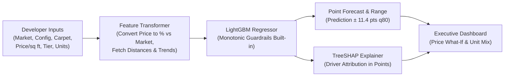

# ANAROCK Absorption Forecaster (Pune Prototype)

> ⚠️ **Prototype Disclaimer:** This prototype is trained on synthetic data calibrated to real Pune residential projects (IndexTap & RERA benchmarks). It is built for feasibility advisory demonstration and evaluation purposes, not for unverified live pricing decisions.

---

## 1. Problem & Context

Before a new residential launch, real estate advisory firms estimate: **"How fast will this project sell?"**
* Historically, this estimate is produced using manual spreadsheets and analyst intuition. It is time-consuming, inconsistent across analysts, and difficult to explain to developers.
* **ANAROCK** already delivers Market Feasibility & Demand Assessment as a high-value consulting service. This application **productises** that capability: delivering an instant, data-driven, and fully explainable 12-month sales absorption forecast with interactive pricing and unit-mix sensitivity.

### Target Users & Decisions
* **Primary User:** ANAROCK research and advisory analysts preparing developer pitch decks.
* **Secondary User:** Developer strategy heads and C-suite leaders reviewing launch feasibility during advisory meetings.
* **Core Decision Supported:** *"At what price per sq ft and unit mix should this project launch to achieve our target absorption (e.g. 35–40%) in the first 12 months?"*
* **Geographic & Asset Scope:** Pune residential market across 5 major micro-markets: **Hinjewadi, Wakad, Baner, Kharadi, and Wagholi** (1BHK to 4BHK).

---

## 2. How It Works



1. **Input Normalisation:** The analyst specifies launch details (e.g. ₹10,000/sq ft for a 2BHK in Hinjewadi). The engine normalises raw pricing into `price_vs_market_pct` relative to the local benchmark (`MARKET_BASE_PSF`).
2. **Constrained Tree Inference:** Evaluates a frozen LightGBM regressor trained with **monotonic guardrails** (higher prices, farther distances, later possession, or lower developer brand tiers can never spuriously increase sales).
3. **Calibrated Confidence Band:** Generates a point prediction alongside an empirical 80th-percentile error margin ($\pm 11.4$ percentage points), clipped between 0% and 100%.
4. **Attribution (TreeSHAP):** Deconstructs the forecast into exact contributions (+/− points) for each factor, automatically generating plain-English bullet points.
5. **Interactive What-If Simulation:**
   * **Price Sensitivity Curve:** Shows absorption across a $-20\%$ to $+25\%$ price band and solves for the maximum viable price to hit a specified sales target.
   * **Unit-Mix Analysis:** Evaluates 1BHK, 2BHK, 3BHK, and 4BHK side-by-side with standard unit configurations.

---

## 3. Model Performance & Validation

Error is measured in **percentage points (pts)**. For example, if actual absorption is 30% and the model predicts 38%, the absolute error is 8 pts.

### Evaluation against Baseline Heuristics

| Evaluation Split | Model / Heuristic | Mean Absolute Error (MAE) | Within $\pm 10$ pts | Bias (pts) |
|---|---|---|---|---|
| **A: Random held-out projects** | Simple Baseline (Market $\times$ Config Median) | 10.7 pts | 56.7% | −1.3 |
| **A: Random held-out projects** | **LightGBM Forecaster** | **8.2 pts** *(~23% lower error)* | **67.5%** | **+0.4** |
| **B: Future launches (cooling market)** | Simple Baseline (Market $\times$ Config Median) | 10.3 pts *(over-predicts by +6.3)* | 55.9% | +6.3 |
| **B: Future launches (cooling market)** | **LightGBM Forecaster** | **6.9 pts** | **73.7%** | **−0.4** |

### Why This Matters in Real Estate Cycles
Standard rule-of-thumb heuristics learned during market booms severely over-predict sales when the market cools (+6.3 pts bias). Because this model includes citywide quarterly sales trends as a core driver, it remains **unbiased (−0.4 pts)** across changing cycle conditions.

### Reality Check vs 6 Real Pune Projects (IndexTap Data)
Because real-world public data reports cumulative lifetime sales rather than isolated Year-1 absorption, the model was tested against historical **plausible bounds**:
* **Floor** = Lifetime monthly pace $\times$ 12 (Year 1 pace is front-loaded and should exceed lifetime average).
* **Ceiling** = Total % sold to date (a project cannot sell more in Year 1 than it has sold across its entire lifetime).

| Project Name | Micro-Market | Launch Price/sq ft | 12-Month Forecast | Plausible Historical Band | Verdict |
|---|---|---|---|---|---|
| Godrej Park World | Hinjewadi | ₹11,000 | **24.7%** | 20% – 55% | **PASS** |
| Gale at Godrej Park World | Hinjewadi | ₹11,000 | **24.7%** | 20% – 54% | **PASS** |
| VJ Palladio Kharadi Central | Kharadi | ₹11,300 | **38.8%** | 25% – 90% | **PASS** |
| Kumar Parth Towers | Baner | ₹10,900 | **37.9%** | 22% – 84% | **PASS** |
| Mantra Monarch | Baner | ₹7,900 | **30.9%** | 13% – 89% | **PASS** |
| Ashiana Malhar (Phase 1) | Hinjewadi | ₹8,800 | **64.9%** | 20% – 86% | **PASS** *(Fringe sub-market note)* |

---

## 4. Key Drivers (SHAP Attribution)

Global feature importance rankings from TreeSHAP:
1. **Market Sales Trend at Launch (6.0 pts avg impact):** Market cycle timing is the single biggest determinant of launch velocity.
2. **Price vs Micro-Market (4.8 pts avg impact):** Pricing above local benchmarks directly compresses absorption.
3. **Developer Tier (3.7 pts avg impact):** Institutional brand trust (Tier 1) provides a strong sales premium.
4. **Distance to IT Hub (3.1 pts avg impact):** Employment corridor proximity drives end-user demand in Pune.
5. **Carpet Area / Unit Size (2.4 pts avg impact):** Larger ticket sizes narrow the eligible buyer pool.
6. **Total Inventory Scale (2.3 pts avg impact):** Large multi-phase launches dilute absorption percentage.
7. **Configuration (1.7 pts avg impact):** 2BHK units consistently exhibit the highest baseline demand.

---

## 5. Known Limitations & Operating Boundaries

1. **Synthetic Training Distribution:** Calibrated against 823 synthetic records tied to real Pune benchmark anchors.
2. **Extrapolation Limits:** Gradient-boosted decision trees cannot extrapolate beyond historical ranges. For instance, market downturns steeper than $-17\%$ require quarterly retraining.
3. **Sub-Market Granularity:** Benchmark pricing is indexed at the micro-market level. Fringe projects (e.g. Marunji in Hinjewadi) may appear artificially discounted. Future versions will index against 2-km radius geospatial clusters.
4. **Coverage Clumping:** Project-level correlation results in ~73% empirical coverage for the 80% confidence band.

---

## 6. How This Plugs into ANAROCK's Proprietary Data

In enterprise production, this pipeline connects directly into ANAROCK’s data infrastructure:
* **Transaction Feeds:** Ingest quarterly RERA and registry transaction feeds to retrain quarterly.
* **Hyperlocal Pricing Grids:** Replace micro-market averages with ANAROCK's proprietary building-level and pin-code-level price indices.
* **CRM Conversion Signals:** Enrich lead-to-booking conversion rates to dynamically adjust absorption expectations.

---

## 7. Local Setup & Running Instructions

### Prerequisites
* Python 3.11, 3.12, or 3.13
* Git

### Installation
```bash
# Clone the repository
git clone https://github.com/YOUR_USERNAME/anarock-absorption-forecaster.git
cd anarock-absorption-forecaster

# Create and activate a virtual environment
python -m venv .venv
# Windows:
.venv\Scripts\activate
# macOS/Linux:
source .venv/bin/activate

# Install dependencies (pinned versions)
pip install -r requirements.txt
```

### Run Tests
```bash
python -m unittest tests/test_forecaster.py -v
```

### Launch the Web App
```bash
streamlit run app.py
```
The app will open automatically at `http://localhost:8501`.

---

## 8. Deployment (Streamlit Community Cloud)

1. Push this repository to GitHub as a public repository (`anarock-absorption-forecaster`).
2. Log in to [Streamlit Community Cloud](https://share.streamlit.io/).
3. Click **"New app"**, select the repository, branch `main`, and main file path `app.py`.
4. *(Optional)* Under **Advanced settings → Secrets**, add your Gemini API key if narrative summaries are desired:
   ```toml
   GEMINI_API_KEY = "your_gemini_api_key_here"
   ```
5. Click **"Deploy!"**. The app will build and go live on a public URL in ~2 minutes.
